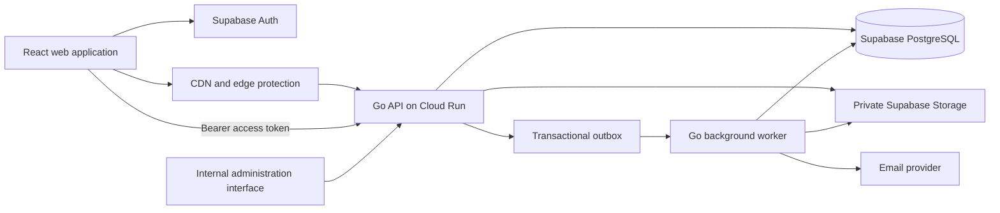
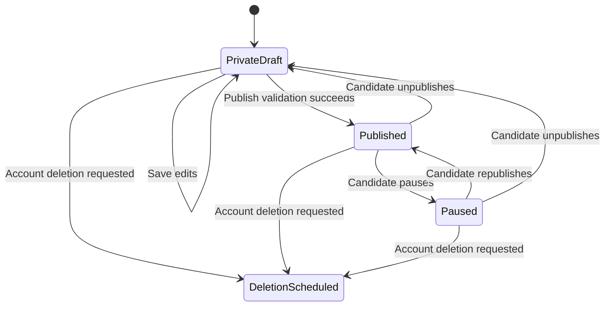
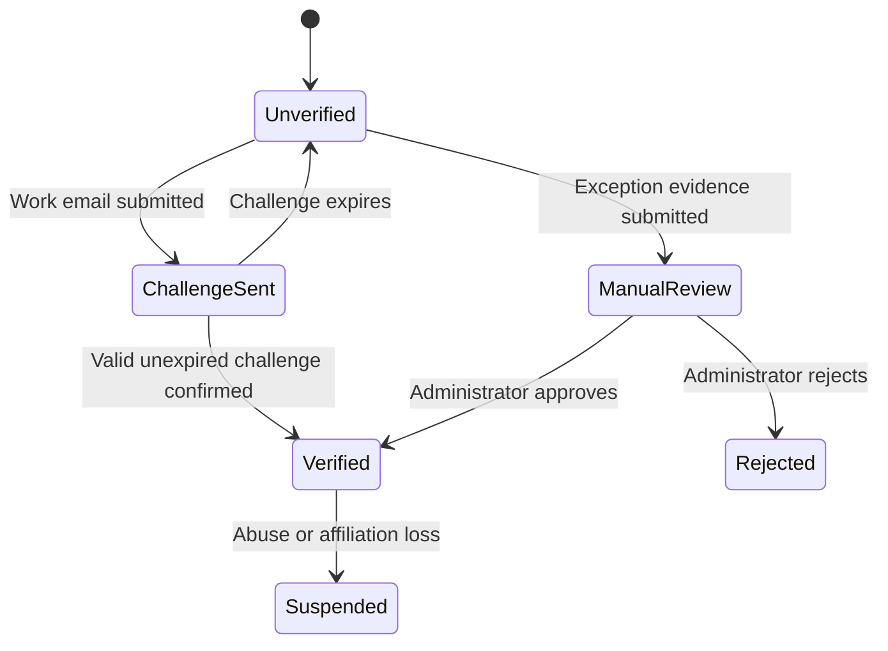

# MassLaidOff Backend Design

## 1. Purpose

This document defines the production backend for MassLaidOff. The backend supports a private, searchable record of professionals affected by layoffs. Verified recruiters can discover candidates and reach out according to each candidate's contact and resume visibility settings.

MassLaidOff is not a job board, applicant-tracking system, or interview-management platform.

## 2. Architectural decision

Use a **Go modular monolith** deployed as a stateless container, with Supabase providing managed PostgreSQL, authentication, and private object storage.

### Production stack

| Concern | Choice |
| --- | --- |
| Web client | React and TypeScript |
| Public application API | Go |
| Architecture | Modular monolith |
| Authentication | Supabase Auth |
| Primary database | Supabase PostgreSQL |
| Database driver | `pgx` with a bounded connection pool |
| Document storage | Private Supabase Storage buckets |
| API hosting | Google Cloud Run |
| Background work | Transactional outbox plus a Go worker; move delivery to Pub/Sub when required |
| Search | PostgreSQL full-text search and `pg_trgm` initially |
| Email | Transactional email provider behind an internal interface |
| SMS/phone OTP | Supabase Auth provider |
| Monitoring | Structured logs, metrics, tracing, and error reporting |

Do not begin with microservices. The domains remain separated inside one deployable service and can be extracted only when measured scale or team ownership requires it.

## 3. System context



## 4. Trust boundaries

### Browser

The browser is untrusted. It may hold only:

- The Supabase public URL
- The Supabase anonymous key
- The authenticated user's short-lived session
- Short-lived signed upload or download URLs

The browser must never receive:

- The Supabase service-role key
- A direct database password
- Storage administration credentials
- Email-provider credentials
- Verification or moderation secrets
- Private document paths belonging to another user

### Go API

The Go API is the only public application-data boundary. It:

- Validates Supabase access tokens
- Resolves the authenticated account and role
- Authorizes every operation
- Applies candidate visibility rules
- Performs database transactions
- Issues short-lived storage URLs
- Adds audit events for sensitive operations
- Applies rate limits and abuse controls
- Creates background jobs through the outbox

### Background worker

The worker has no public HTTP endpoint except restricted health or queue-delivery endpoints. It performs:

- Transactional email delivery
- Document scanning and metadata validation
- Verification workflows
- Document-retention deletion
- Contact-request expiry
- Account-deletion execution
- Public-metric aggregation
- Search-document refreshes when required

### Administrative access

Administrative actions use separate routes, separate authorization checks, and separate database permissions. A user must never become an administrator merely by changing an account row.

## 5. Backend principles

1. **Default deny:** absence of an explicit authorization rule means access is rejected.
2. **Private data separation:** contact details, manager LinkedIn URLs, evidence documents, and review authorship never appear in directory queries.
3. **Server-owned trust fields:** clients cannot write roles, verification results, moderation results, audit metadata, or retention status.
4. **Consent is enforceable state:** contact and resume access are evaluated on every request, not only when the interface renders a button.
5. **Short-lived document access:** files are private and accessed only using narrowly scoped expiring URLs.
6. **Auditable sensitive reads:** contact reveals, resume downloads, evidence reads, verification actions, and moderation actions are recorded.
7. **Idempotent commands:** retrying an API command must not create duplicate requests, grants, emails, or documents.
8. **One production truth:** sample data and demo-success messages do not participate in live application paths.

## 6. Go service structure

```text
backend/
├── cmd/
│   ├── api/
│   │   └── main.go
│   ├── worker/
│   │   └── main.go
│   └── migrate/
│       └── main.go
├── internal/
│   ├── platform/
│   │   ├── config/
│   │   ├── database/
│   │   ├── httpserver/
│   │   ├── logging/
│   │   ├── telemetry/
│   │   ├── storage/
│   │   ├── email/
│   │   └── queue/
│   ├── auth/
│   ├── accounts/
│   ├── candidates/
│   ├── companies/
│   ├── recruiters/
│   ├── contacts/
│   ├── documents/
│   ├── verification/
│   ├── reviews/
│   ├── moderation/
│   ├── safety/
│   ├── statistics/
│   └── administration/
├── migrations/
├── tests/
├── go.mod
├── go.sum
└── Dockerfile
```

Each domain package contains its HTTP handlers, service rules, repository interface, database implementation, and domain-specific tests. Domains communicate through service interfaces rather than importing another domain's database implementation.

## 7. Runtime components

### API process

The API process handles synchronous user requests. It must remain stateless so Cloud Run can add or remove instances safely.

### Worker process

The worker uses the same repository and domain packages but has a different executable. It processes jobs outside the user request lifecycle.

### Migration process

Database migrations run as an explicit release step. The API must not automatically modify the schema during startup.

## 8. Authentication design

### Supported methods

- Personal email magic link or OTP
- Phone OTP
- Recruiter work-email verification as a separate product verification, not the primary login identity

### Request authentication

1. The user authenticates with Supabase Auth.
2. The browser receives a Supabase access token.
3. The browser sends `Authorization: Bearer <token>` to the Go API.
4. The API validates the signature, issuer, audience, expiry, and subject using Supabase's signing keys.
5. The API loads the application account using the token subject.
6. The handler executes with an immutable request actor containing user ID, account type, verification state, and request ID.

The API must not trust role or verification values supplied in request JSON.

### Account creation

The first authenticated API call creates or completes `user_accounts` and `private_contacts` inside one transaction. Account type can be selected once by the user between `candidate` and `recruiter`. Changing account type later requires a dedicated workflow.

`admin` can only be assigned through an operational process outside public user APIs.

## 9. Authorization model

### Public visitor

Can read:

- Landing-page configuration
- Thresholded public statistics
- Published manager-review projections approved for public display

Cannot read any candidate profile.

### Candidate

Can:

- Manage their own profile, contacts, employment, layoff records, documents, consents, requests, and grants
- Preview their recruiter-visible profile
- Publish, pause, and unpublish their profile
- Submit and manage eligible manager reviews
- Export their data
- Request deletion

Cannot:

- Set their verification status
- Set moderation status
- Read other candidates' private records
- Read recruiter private notes

### Verified recruiter

Can:

- Search published candidate projections
- Read recruiter-visible candidate detail
- Manage their own shortlist and notes
- Create contact requests
- Read contact fields or resumes only when candidate visibility or an active grant permits it

Cannot:

- Read company emails used for verification
- Read salary slips or exit letters
- Read manager LinkedIn URLs
- Read review authorship
- Set their own verification status

### Administrator or moderator

Can perform only the operations granted to their internal role. Verification, review moderation, user safety, and system administration should be distinct permissions even if one employee initially holds all of them.

## 10. Database access model

### Application roles

Use separate database credentials or roles for:

- `masslaidoff_api`: ordinary application operations
- `masslaidoff_worker`: scheduled and asynchronous operations
- `masslaidoff_admin`: restricted administrative commands
- `masslaidoff_migrator`: schema changes only

The ordinary API role must not have `BYPASSRLS`, ownership of application tables, or unrestricted access to private data.

### Access approach

- Public reads use purpose-built safe views or SQL functions.
- User writes use narrowly scoped repository queries with actor ownership conditions.
- Sensitive state transitions use database functions or transactions that validate the current state.
- Verification and moderation fields are excluded from ordinary update statements.
- The admin role is invoked only by admin services after permission checks and audit creation.

### Row-level security

Keep row-level security enabled as defense in depth. Browser clients must not be granted general access to base application tables. If any browser-to-Supabase operation remains, it must use an intentionally limited policy and safe projection.

Before launch, remove or replace policies that allow users to update:

- `user_accounts.account_type` after onboarding
- Any `verification_status`
- `verified_at` or `verified_by`
- Review moderation status and notes
- Audit-event actor or IP metadata
- Retention or deletion completion status

## 11. Core domain modules

### Accounts

Responsibilities:

- Onboarding
- Account role selection
- Personal contact management
- Consent records
- Account status
- Data export orchestration
- Deletion requests

### Candidates

Responsibilities:

- Candidate profile lifecycle
- Employment records
- Layoff records
- Skill management
- Publication validation
- Recruiter-visible projection
- Search indexing fields

### Recruiters

Responsibilities:

- Recruiter profile
- Company affiliation
- Verification state
- Candidate directory permissions
- Shortlists and private notes
- Profile-view audit events

### Contacts

Responsibilities:

- Contact requests
- Candidate decisions
- Field-specific contact grants
- Grant expiry and revocation
- Safe contact projection

### Documents

Responsibilities:

- Upload authorization
- Upload finalization
- Metadata validation
- Malware scan state
- Resume visibility
- Evidence isolation
- Signed download URLs
- Retention deletion

### Verification

Responsibilities:

- Company-email challenges
- Candidate employment verification
- Layoff verification
- Recruiter company verification
- Manual review queues
- Verification audit history

### Reviews and moderation

Responsibilities:

- Manager-review eligibility
- Private manager identity matching
- Structured ratings
- Moderation workflow
- Public-safe review projection
- Reports, corrections, removals, and appeals

### Statistics

Responsibilities:

- Daily aggregate calculation
- Consent-aware inclusion
- Minimum-group thresholds
- Public API caching
- Suppression of identifying segments

## 12. API conventions

### Base path

All production endpoints begin with `/v1`.

### Response envelope

Successful single-resource response:

```json
{
  "data": {},
  "request_id": "req_..."
}
```

Collection response:

```json
{
  "data": [],
  "page": {
    "next_cursor": "...",
    "has_more": true
  },
  "request_id": "req_..."
}
```

Error response:

```json
{
  "error": {
    "code": "candidate_not_publishable",
    "message": "Complete the required profile fields before publishing.",
    "fields": {
      "resume": "A resume is required."
    }
  },
  "request_id": "req_..."
}
```

### General rules

- Use cursor pagination rather than page-number offsets for candidate search and reviews.
- Accept an `Idempotency-Key` header for commands that create requests, grants, uploads, reviews, or deletion jobs.
- Return UTC timestamps using RFC 3339.
- Enforce request-body size limits.
- Reject unknown fields on security-sensitive commands.
- Use stable machine-readable error codes.

## 13. API surface

### Session and onboarding

| Method | Path | Purpose |
| --- | --- | --- |
| `GET` | `/v1/me` | Current account and onboarding state |
| `POST` | `/v1/me/onboarding` | Select candidate or recruiter and create account records |
| `PATCH` | `/v1/me` | Update common profile fields |
| `GET` | `/v1/me/contacts` | Read own private contacts |
| `PATCH` | `/v1/me/contacts` | Update own private contacts |
| `POST` | `/v1/me/consents` | Grant a versioned consent |
| `DELETE` | `/v1/me/consents/{type}` | Revoke consent and apply dependent state changes |
| `GET` | `/v1/me/export` | Request or download a personal-data export |
| `POST` | `/v1/me/deletion-request` | Schedule account deletion |
| `DELETE` | `/v1/me/deletion-request` | Cancel pending deletion |

### Candidate profile

| Method | Path | Purpose |
| --- | --- | --- |
| `GET` | `/v1/candidate/me` | Load private candidate profile |
| `PUT` | `/v1/candidate/me` | Create or replace candidate profile draft |
| `PATCH` | `/v1/candidate/me` | Update selected draft fields |
| `GET` | `/v1/candidate/me/preview` | Exact recruiter-visible projection |
| `POST` | `/v1/candidate/me/publish` | Validate and publish profile |
| `POST` | `/v1/candidate/me/pause` | Pause discovery |
| `POST` | `/v1/candidate/me/unpublish` | Return profile to private draft |
| `GET` | `/v1/candidate/me/employments` | List own employment records |
| `POST` | `/v1/candidate/me/employments` | Add employment record |
| `PATCH` | `/v1/candidate/me/employments/{id}` | Update employment record |
| `DELETE` | `/v1/candidate/me/employments/{id}` | Delete employment record |
| `PUT` | `/v1/candidate/me/employments/{id}/private-details` | Save owner-only manager information |
| `PUT` | `/v1/candidate/me/employments/{id}/layoff` | Create or update layoff record |

### Recruiter profile and discovery

| Method | Path | Purpose |
| --- | --- | --- |
| `GET` | `/v1/recruiter/me` | Load recruiter profile and verification state |
| `PUT` | `/v1/recruiter/me` | Create or update recruiter-controlled fields |
| `POST` | `/v1/recruiter/me/company-email/challenge` | Start company-email verification |
| `POST` | `/v1/recruiter/me/company-email/confirm` | Confirm one-time challenge |
| `GET` | `/v1/recruiter/candidates` | Search published candidate projections |
| `GET` | `/v1/recruiter/candidates/{id}` | Read recruiter-visible candidate detail |
| `GET` | `/v1/recruiter/shortlist` | List saved candidates |
| `PUT` | `/v1/recruiter/shortlist/{candidate_id}` | Save candidate or update private note |
| `DELETE` | `/v1/recruiter/shortlist/{candidate_id}` | Remove candidate |

### Documents

| Method | Path | Purpose |
| --- | --- | --- |
| `POST` | `/v1/candidate/me/documents/uploads` | Request a signed upload |
| `POST` | `/v1/candidate/me/documents/uploads/{upload_id}/complete` | Validate and record completed upload |
| `GET` | `/v1/candidate/me/documents` | List own document metadata |
| `DELETE` | `/v1/candidate/me/documents/{id}` | Remove own document |
| `POST` | `/v1/recruiter/candidates/{id}/resume-download` | Get authorized short-lived resume URL |

There is no recruiter endpoint for salary slips, exit letters, or other verification evidence.

### Contact requests and grants

| Method | Path | Purpose |
| --- | --- | --- |
| `POST` | `/v1/recruiter/candidates/{id}/contact-requests` | Request candidate contact access |
| `GET` | `/v1/recruiter/contact-requests` | Recruiter's requests |
| `GET` | `/v1/candidate/me/contact-requests` | Candidate's received requests |
| `POST` | `/v1/candidate/me/contact-requests/{id}/accept` | Accept with explicit fields and expiry |
| `POST` | `/v1/candidate/me/contact-requests/{id}/decline` | Decline request |
| `GET` | `/v1/recruiter/candidates/{id}/contact` | Read only currently authorized fields |
| `DELETE` | `/v1/candidate/me/contact-grants/{id}` | Revoke grant |

### Manager reviews

| Method | Path | Purpose |
| --- | --- | --- |
| `POST` | `/v1/candidate/me/reviews` | Submit review for moderation |
| `GET` | `/v1/candidate/me/reviews` | List own review submissions and status |
| `PATCH` | `/v1/candidate/me/reviews/{id}` | Edit draft or returned review |
| `DELETE` | `/v1/candidate/me/reviews/{id}` | Withdraw eligible review |
| `GET` | `/v1/reviews` | Read published safe review projection |
| `POST` | `/v1/reviews/{id}/reports` | Report published review |

### Public statistics

| Method | Path | Purpose |
| --- | --- | --- |
| `GET` | `/v1/public/statistics/summary` | Latest thresholded totals |
| `GET` | `/v1/public/statistics/trends` | Thresholded time-series data |
| `GET` | `/v1/public/statistics/distributions` | Thresholded role, location, and experience groups |

### Safety

| Method | Path | Purpose |
| --- | --- | --- |
| `POST` | `/v1/reports/users` | Report a user or profile |
| `GET` | `/v1/me/blocks` | List own blocks |
| `PUT` | `/v1/me/blocks/{user_id}` | Block user |
| `DELETE` | `/v1/me/blocks/{user_id}` | Unblock user |

### Administration

Administrative endpoints live under `/v1/admin` and require explicit internal permissions.

- Verification queue and decisions
- Review moderation and correction requests
- User reports and restrictions
- Retention exceptions
- Company canonicalization
- Audit-event search
- Metric-job status

## 14. Candidate publication workflow



Publication is rejected unless the candidate has:

- A completed account record
- Verified personal email or phone
- Full name, headline, role, location, experience, and short introduction
- At least one skill
- Latest employment record
- Layoff or last-working date
- Active resume
- Contact and resume visibility choices
- Active privacy-policy consent

Employment verification is encouraged but not required for publication. The profile shows its accurate verification state.

## 15. Recruiter verification workflow



Rules:

- Corporate email verification is separate from login.
- Challenge tokens are random, single-use, short-lived, and stored only as hashes.
- Consumer email domains cannot satisfy company verification.
- The verified email domain must match the selected company or enter manual review.
- Changing company or work email removes recruiter verification until reverified.
- Verification fields are server-owned.

## 16. Contact-access evaluation

The API evaluates contact access when the recruiter requests the contact endpoint.

```text
deny if requester is not an active verified recruiter
deny if candidate is blocked, private, paused, or deletion-scheduled
deny if candidate contact mode is hidden

if mode is verified_recruiters:
    return only fields enabled by the candidate

if mode is request_access:
    require an accepted, unexpired, non-revoked grant
    return only fields listed in that grant

record a sensitive-read audit event
```

Contact values are returned only from a dedicated safe DTO. The API never serializes the complete `private_contacts` row.

## 17. Document security design

### Buckets

- `candidate-resumes`
- `employment-evidence`
- `profile-avatars`

All buckets are private. Public avatar delivery, if desired, should use a sanitized derivative rather than making the entire source bucket public.

### Upload sequence

1. Candidate requests an upload with document type, MIME type, and size.
2. API validates ownership, type, size, rate limit, and filename extension.
3. API creates a pending upload ID and generated storage key.
4. API issues a short-lived signed upload URL.
5. Browser uploads directly to storage.
6. Browser calls the completion endpoint.
7. API verifies the object exists and validates its actual metadata.
8. API creates the document row with `processing` status.
9. Worker scans the document and marks it `available` or `quarantined`.

### Download sequence

- Candidate downloads require ownership.
- Recruiter resume downloads require verified recruiter status and current resume authorization.
- Evidence downloads require candidate ownership or an audited administrator permission.
- URLs expire after five minutes or less.
- Every sensitive download creates an audit event.

### Retention

- Salary slips: delete no later than 30 days after a verification decision.
- Exit or relieving letters: delete no later than 90 days after a verification decision.
- Rejected or abandoned evidence: delete within 30 days.
- Resumes: retain until replaced, removed, or account deletion completes.

A daily retention job selects eligible objects, deletes storage objects, and then marks the metadata deletion result. Failures are retried and alerted.

## 18. Candidate search design

### Search document

Maintain a safe search projection containing only recruiter-visible fields:

- Candidate ID
- Full name
- Headline and primary role
- Discipline
- Location and preferred locations
- Years of experience
- Skills
- Industry
- Former company
- Remote preference
- Availability date
- Verification badge
- Resume-availability flag, not its path
- Publication timestamp

### Query behavior

- Require an active verified recruiter.
- Use cursor pagination with a deterministic tie-breaker.
- Cap page size at 50.
- Normalize and limit filter counts.
- Use PostgreSQL `tsvector` plus trigram similarity for keyword search.
- Use B-tree or GIN indexes for exact filters and arrays.
- Return a safe DTO rather than database rows.
- Record coarse search metrics without storing unnecessary personal query data.

### Scaling path

1. Start with indexed PostgreSQL search.
2. Add query-performance monitoring and slow-query logs.
3. Add short-lived caching only for non-personal aggregate lookups.
4. Add a read replica when measured read load justifies it.
5. Introduce a dedicated search engine only when PostgreSQL cannot meet measured ranking or latency requirements.

## 19. Manager-review safety

- Review authorship and manager matching remain in private tables.
- Public review responses never include author ID, employment ID, manager LinkedIn URL, or moderation notes.
- The manager's displayed identity follows the policy in `PRODUCT_SPEC.md`.
- Submission requires authenticated candidate status and a matching employment record.
- Publishing requires moderation.
- Edits to published reviews create a new moderation revision rather than silently replacing published text.
- Reports can temporarily hide a review when risk thresholds are met.
- Every moderation decision records moderator, timestamp, reason, and previous state.

The base review table must not be selectable through the browser-facing database API.

## 20. Statistics privacy

Raw candidate rows are never downloaded to calculate public charts.

A scheduled worker creates aggregate rows using only candidates who consented to statistics. The public API returns:

- Global totals
- Segments with at least 10 candidates
- Company-level segments with at least 20 candidates
- Weekly or monthly dates rather than identifying event timestamps

Small categories are suppressed or combined into `Other` before leaving the database.

## 21. Background jobs

Use an `outbox_events` table written in the same transaction as the initiating state change.

Suggested event types:

- `account.created`
- `candidate.published`
- `candidate.paused`
- `recruiter.verification_challenge_requested`
- `recruiter.verified`
- `contact_request.created`
- `contact_request.accepted`
- `contact_grant.revoked`
- `document.upload_completed`
- `document.retention_due`
- `review.submitted`
- `review.moderated`
- `account.deletion_scheduled`
- `account.deletion_due`
- `statistics.daily_rebuild`

Worker requirements:

- Claim jobs using transactional locking.
- Retry transient failures with exponential backoff.
- Move permanently failing jobs to a dead-letter state.
- Use idempotency keys for external providers.
- Emit metrics for queue age, attempt count, and failures.
- Never log document contents or contact values.

When database-backed delivery becomes a bottleneck, publish outbox events to Pub/Sub without changing domain services.

## 22. Rate limits and abuse controls

Apply limits by IP, authenticated account, and operation.

Initial limits should include:

- Authentication challenge requests
- Recruiter verification attempts
- Candidate searches
- Candidate profile views
- Contact requests per recruiter and candidate
- Resume downloads
- Review submissions
- Reports and blocks
- Signed upload requests
- Data exports

Suspicious recruiter behavior, such as rapidly enumerating profiles or contacts, should trigger throttling and a safety event.

## 23. Audit events

Audit at minimum:

- Contact detail revealed
- Resume downloaded
- Evidence viewed by an administrator
- Verification approved or rejected
- Recruiter access suspended or restored
- Review published, rejected, removed, or corrected
- Consent granted or revoked
- Data export generated
- Account deletion scheduled, cancelled, or completed
- Administrative permission change

Audit fields are server-generated. Clients cannot choose actor, IP address, request ID, or action name.

## 24. Data deletion

Account deletion uses a 30-day grace period.

When deletion becomes due, the worker:

1. Unpublishes the profile immediately if it is still visible.
2. Revokes contact grants and active sessions.
3. Deletes stored documents and avatars.
4. Deletes or anonymizes relational data according to policy.
5. Preserves only legally required security or moderation records with restricted access.
6. Marks the request complete.
7. Sends confirmation without including sensitive data.

Deletion must be restartable and idempotent.

## 25. Error handling

- Wrap internal errors with operation context.
- Map domain errors to stable public error codes.
- Never return SQL, stack traces, provider responses, or secrets to clients.
- Log errors with request ID, actor ID when authenticated, operation, and safe metadata.
- Treat authorization failures consistently to avoid revealing whether private records exist.

## 26. Observability

### Logs

Use structured JSON logs with:

- Timestamp
- Severity
- Service and version
- Request ID and trace ID
- Route and method
- Response status
- Duration
- Authenticated actor ID when applicable
- Safe error code

Do not log tokens, personal emails, phone numbers, review drafts, document names, signed URLs, or uploaded content.

### Metrics

Track:

- Request count, latency, and error rate by route
- Authentication and authorization failures
- Database pool usage and query latency
- Candidate search latency and result counts
- Signed upload and download outcomes
- Contact-request conversion and failures
- Queue depth, queue age, retry count, and dead letters
- Verification and moderation backlog age
- Retention and deletion job failures

### Alerts

Alert on sustained API error rates, exhausted database pools, abnormal contact reads, failed retention jobs, queue backlog, and elevated authentication abuse.

## 27. Deployment topology

### Cloud Run API

- Minimum instances: 1 for predictable launch latency
- Maximum instances: start between 10 and 20
- Concurrency: begin around 40 requests per instance and tune using load tests
- CPU and memory: begin with 1 vCPU and 512 MiB–1 GiB
- Request timeout: 15 seconds for ordinary APIs
- Health endpoints: `/health/live` and `/health/ready`

### Cloud Run worker

- No public ingress
- Small controlled concurrency
- Independent deployment and scaling from the API
- Explicit maximum parallelism for document and database safety

### Database pool

The total possible connection count across all API and worker instances must remain below the Supabase pool limit. Start with a small per-instance pool and cap Cloud Run instances to prevent a traffic spike from exhausting PostgreSQL.

### Region

Place the API, worker, database, and storage in the same or nearest available region for the India-first launch. Cross-region calls should not sit on the main request path.

## 28. Configuration and secrets

Validate required configuration during startup:

- Environment name
- Public API origin
- Allowed frontend origins
- Supabase project URL and JWT issuer
- Database connection string
- Storage credentials
- Email-provider credentials
- Token-hashing secret
- Error-reporting and telemetry configuration

Production secrets live in a managed secret store and are mounted or injected at runtime. They are never committed to the repository or exposed through Vite environment variables.

## 29. Testing strategy

### Unit tests

- Publication validation
- Contact-access decisions
- Resume-access decisions
- Verification transitions
- Review transitions
- Threshold suppression
- Retention-date calculation
- Error mapping

### Repository integration tests

Run against a disposable PostgreSQL database with real migrations:

- Ownership enforcement
- Verification-field protection
- Safe views
- Concurrent contact decisions
- Idempotency
- Cursor pagination
- Transaction rollback
- Retention selection

### API tests

- Missing, expired, and invalid tokens
- Candidate/recruiter/admin role boundaries
- Request validation
- Rate limiting
- Signed upload completion
- Contact grant reveal and revocation
- Review anonymity
- Public statistic suppression

### End-to-end tests

1. Candidate authenticates, completes profile, uploads resume, previews, and publishes.
2. Unverified recruiter cannot search candidates.
3. Recruiter verifies company email and can search.
4. Recruiter requests contact access.
5. Candidate grants email but not phone or resume.
6. Recruiter receives only email.
7. Candidate revokes the grant and access stops immediately.
8. Candidate submits a manager review and public output remains anonymous.
9. Account deletion unpublishes immediately and later removes retained data.

### Load tests

Measure:

- Candidate search at expected and peak concurrency
- Candidate profile reads
- Contact-request bursts
- Public statistics traffic
- Signed upload issuance
- Database connection behavior during Cloud Run scale-out

## 30. Migration strategy

The current two SQL migrations were written while the product model was changing. Before connecting production users:

1. Decide whether either migration has been applied to a persistent environment.
2. If not applied, replace them with one clean production baseline migration.
3. If already applied, add corrective migrations; never rewrite production migration history.
4. Remove private fields from publicly selectable tables.
5. Preserve migrated values before dropping old columns.
6. Replace broad `for all` policies with operation-specific policies.
7. Remove client control over roles, verification, moderation, and audit fields.
8. Add safe views/functions and revoke base-table access where appropriate.
9. Apply migrations to a disposable database in CI.
10. Run authorization and privacy integration tests before promotion.

## 31. Implementation phases

### Phase 1: Foundation

- Create Go workspace and service skeleton
- Configuration, logging, request IDs, health checks
- Supabase JWT validation
- PostgreSQL pool and migration runner
- Error and response conventions
- Local development environment

### Phase 2: Database security

- Clean production schema
- Server-owned fields
- Safe views and database roles
- Correct row-level policies
- Audit and outbox tables
- Migration integration tests

### Phase 3: Candidate launch path

- Onboarding
- Candidate profile, employment, layoff, and skills
- Private contacts
- Document upload and finalization
- Preview, publication, pause, and deletion

### Phase 4: Recruiter launch path

- Recruiter profile
- Company-email verification
- Candidate search and detail
- Shortlists and notes
- View auditing and rate limits

### Phase 5: Contact and documents

- Contact requests
- Candidate decisions
- Field-specific grants
- Secure contact projection
- Resume download authorization
- Retention worker

### Phase 6: Reviews and administration

- Manager reviews
- Moderation and reporting
- Verification administration
- Safety actions and appeals
- Administrative audit interface

### Phase 7: Statistics and launch hardening

- Consent-aware aggregate jobs
- Public statistic endpoints
- Load testing
- Security testing
- Backup and restore rehearsal
- Monitoring and alerts
- Production deployment checklist

## 32. Launch gates

MassLaidOff must not accept real sensitive documents until all of the following are true:

- Authorization tests pass for candidate, recruiter, moderator, administrator, and anonymous users.
- No client can set its own role or verification state.
- Candidate directory access requires an active verified recruiter.
- Contact fields are disclosed only through the dedicated authorization endpoint.
- Exit letters and salary slips cannot be accessed by recruiters.
- Published reviews cannot reveal their author or manager LinkedIn URL.
- Public statistics are thresholded before leaving the database.
- Document retention and account deletion jobs have been tested.
- Database backups and restoration have been rehearsed.
- Rate limiting, audit logging, monitoring, and incident alerts are active.
- Privacy, terms, review, and retention policies have completed legal review.

## 33. Final backend decision

MassLaidOff will launch with a Go modular monolith, Supabase Auth, Supabase PostgreSQL, and private Supabase Storage. The React client authenticates through Supabase but uses the Go API for production application data. PostgreSQL handles search initially. A separate Go worker handles verification, notifications, moderation support, retention, deletion, and aggregate statistics.

This design supports a fast initial launch while preserving a clear path to higher traffic through stateless API scaling, bounded database connections, read replicas, queue-based background work, and an optional dedicated search service only when measurements justify it.
