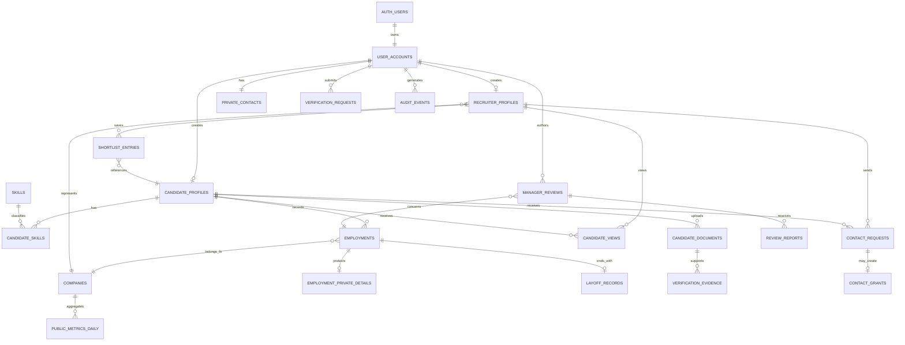

# MassLaidOff Product Specification

## 1. Product summary

MassLaidOff is a searchable record of professionals affected by layoffs. A job seeker creates a verified professional profile, records their employment and layoff information, uploads supporting documents, and decides how verified recruiters may contact them.

Recruiters and hiring managers create verified profiles, search the directory, inspect candidate profiles, save promising people, and reach out. MassLaidOff does not operate as a job board or applicant-tracking system.

### Product principles

- Respect people affected by layoffs; never present them as a public layoff wall.
- Make candidate onboarding quick even when verification documents are not immediately available.
- Keep sensitive employment evidence private.
- Give candidates explicit control over contact visibility.
- Allow only verified recruiters to access recruiter-only profile information.
- Keep anonymous manager reviews separate from hiring profiles.
- Publish only aggregated, privacy-safe statistics.

## 2. Product boundaries

### Included

- Candidate and recruiter authentication
- Candidate profile builder
- Employment and layoff records
- Private document uploads
- Recruiter verification
- Searchable candidate directory
- Recruiter shortlists and private notes
- Candidate contact visibility controls
- Optional contact-access requests
- Anonymous manager reviews
- Review moderation and reporting
- Public aggregate statistics
- Profile, document, and account deletion controls

### Not included

- Job listings
- Job applications
- Interview pipelines
- Offer management
- Applicant tracking
- Recruiter-to-candidate in-app chat for the initial release
- Public access to personal contact information
- Public access to salary slips, exit letters, or manager LinkedIn URLs

## 3. User types

### Candidate

A professional affected by a layoff who wants to become discoverable to recruiters.

The candidate can:

- Create and publish a professional profile
- Add work experience and exact organization or team information
- Record layoff information
- Upload a resume, exit letter, and salary slip
- Control who can see contact information and the resume
- See a preview of the recruiter-visible profile
- Pause or remove the profile
- Write an anonymous manager review
- Report misuse and block recruiters

### Recruiter or hiring manager

A verified hiring professional looking for available talent.

The recruiter can:

- Create a professional profile
- Verify their company email
- Search and filter published candidate profiles
- Open recruiter-visible candidate profiles
- Save candidates and write private notes
- Contact candidates according to their visibility settings
- Request contact access when required
- Report suspicious or abusive content

### Administrator or moderator

An internal operator responsible for trust and safety.

The administrator can:

- Review recruiter and employment verification cases
- Moderate manager reviews
- Process reports and appeals
- Suspend abusive accounts
- View access audit events when investigating misuse
- Manage canonical company records

## 4. Core user journeys

### Candidate journey

1. Sign up with a personal email or phone number.
2. Verify the primary login method.
3. Enter basic professional information.
4. Add the latest company, role, team or organization, dates, and layoff details.
5. Optionally verify employment using a former company email or document.
6. Upload a resume and optional supporting documents.
7. Choose resume and contact visibility.
8. Preview exactly what recruiters will see.
9. Publish the profile.
10. Pause, edit, export, or delete the profile at any time.

### Recruiter journey

1. Sign up and select recruiter or hiring manager.
2. Add current company, role, work email, and LinkedIn URL.
3. Verify the company email.
4. Search candidates by role, skills, experience, location, company, availability, and remote preference.
5. Open a profile and review its professional information.
6. Save the candidate to a shortlist or reach out using the allowed contact method.
7. If contact details require approval, send a short access request.

### Manager review journey

1. A candidate selects one of their employment records.
2. They enter the manager's name and LinkedIn URL privately.
3. They submit structured ratings and a first-person written review.
4. The review enters moderation.
5. The published review does not expose the author's identity, candidate profile, or manager LinkedIn URL.

## 5. Information visibility

| Information | Candidate owner | Verified recruiter | Public visitor |
| --- | --- | --- | --- |
| Published professional profile | Yes | Yes | Limited or no access, based on launch policy |
| Personal email and phone | Yes | Based on candidate setting | No |
| Former company email | Yes | Verification badge only | No |
| Resume | Yes | Based on candidate setting | No |
| Exit letter | Yes | No | No |
| Salary slip | Yes | No | No |
| Exact internal organization | Yes | If candidate enables it | No |
| Manager LinkedIn URL | Yes | No | No |
| Recruiter shortlist notes | No | Owning recruiter only | No |
| Published manager review | Yes | Yes | Yes |
| Manager review author identity | Internal moderation only | No | No |
| Aggregate statistics | Yes | Yes | Yes |

### Candidate contact modes

- `verified_recruiters`: verified recruiters can see approved contact fields immediately.
- `request_access`: recruiters see a contact button and must request access.
- `hidden`: contact details are hidden; the profile can remain searchable.

Email, phone, and resume visibility should be independently configurable.

## 6. Screens

### Public screens

1. Landing page
2. How it works
3. Public statistics and trends
4. Published anonymous manager reviews, if enabled at launch
5. Privacy policy, terms, community standards, and review guidelines

### Candidate screens

1. Candidate sign-up and login
2. Role selection and onboarding
3. Profile builder
4. Employment and layoff details
5. Document upload and verification status
6. Contact and resume visibility settings
7. Recruiter-visible profile preview
8. Published profile management
9. Anonymous manager review form
10. Submitted review status
11. Account, export, and deletion settings

### Recruiter screens

1. Recruiter sign-up and login
2. Recruiter profile and company verification
3. Candidate search and filters
4. Candidate detail
5. Shortlist
6. Contact-access requests
7. Account settings

### Administrative screens

1. Verification queue
2. Manager review moderation queue
3. Reports and appeals
4. Company record management
5. User restrictions and audit history

## 7. Candidate profile fields

### Required for publication

- Full name
- Headline or target role
- Location
- Years of experience
- Short introduction
- At least one skill
- Latest company
- Latest role
- Employment start date
- Layoff or last-working date
- Personal email or phone verification
- Resume
- Contact visibility selection
- Consent to the current privacy policy

### Optional

- Profile photo
- LinkedIn URL
- Preferred locations
- Remote preference
- Availability date
- Exact organization and team
- Additional employment history
- Company email verification
- Exit letter
- Last-month salary slip
- Manager name and LinkedIn URL

## 8. Recruiter search filters

- Keyword
- Current or former role
- Skills
- Years of experience
- Location
- Remote availability
- Former company
- Industry
- Availability date
- Profile verification status
- Resume availability
- Recently published

Search results must never include private contact values, private document paths, review authorship, or manager identifiers.

## 9. Database model

## 10. Database tables

### `user_accounts`

Common application identity linked one-to-one with `auth.users`.

| Column | Type | Notes |
| --- | --- | --- |
| `id` | `uuid` | Primary key and foreign key to `auth.users.id` |
| `account_type` | enum | `candidate`, `recruiter`, `admin` |
| `full_name` | `text` | Required |
| `avatar_path` | `text` | Private storage path or approved public asset |
| `linkedin_url` | `text` | Optional |
| `onboarding_completed_at` | `timestamptz` | Nullable |
| `created_at` | `timestamptz` | Required |
| `updated_at` | `timestamptz` | Required |

### `private_contacts`

Private contact information must not be stored in the searchable candidate table.

| Column | Type | Notes |
| --- | --- | --- |
| `user_id` | `uuid` | Primary key |
| `personal_email` | `citext` | Optional when phone is the login method |
| `personal_email_verified_at` | `timestamptz` | Nullable |
| `company_email` | `citext` | Optional employment or recruiter verification |
| `company_email_verified_at` | `timestamptz` | Nullable |
| `phone_country_code` | `text` | Optional |
| `phone_number` | `text` | Store normalized and encrypted where practical |
| `phone_verified_at` | `timestamptz` | Nullable |
| `preferred_contact_method` | enum | `email`, `phone`, `either` |

### `candidate_profiles`

Contains recruiter-searchable candidate information only.

| Column | Type | Notes |
| --- | --- | --- |
| `id` | `uuid` | Primary key |
| `user_id` | `uuid` | Unique owner |
| `headline` | `text` | Target role or professional headline |
| `short_intro` | `text` | Short professional summary |
| `location` | `text` | Searchable |
| `primary_role` | `text` | Searchable |
| `years_experience` | `numeric` | Non-negative |
| `open_to_remote` | `boolean` | Searchable |
| `preferred_locations` | `text[]` | Optional |
| `available_from` | `date` | Optional |
| `visibility` | enum | `private`, `published`, `paused` |
| `contact_visibility` | enum | `verified_recruiters`, `request_access`, `hidden` |
| `resume_visibility` | enum | `verified_recruiters`, `request_access`, `hidden` |
| `verification_status` | enum | `unverified`, `pending`, `verified`, `rejected` |
| `profile_completion` | `smallint` | 0–100 |
| `published_at` | `timestamptz` | Nullable |
| `created_at` | `timestamptz` | Required |
| `updated_at` | `timestamptz` | Required |

### `skills` and `candidate_skills`

Use normalized skills for reliable filters while retaining candidate-entered display text when needed.

`skills`: `id`, `name`, `slug`, `category`, `approved`.

`candidate_skills`: `candidate_id`, `skill_id`, `years_experience`, `display_order`.

### `companies`

Canonical company records prevent duplicate spellings.

`id`, `name`, `slug`, `website`, `linkedin_url`, `logo_url`, `industry`, `verified`, timestamps.

### `employments`

`id`, `candidate_id`, `company_id`, `role_title`, `org_name`, `team_name`, `location`, `started_at`, `ended_at`, `is_latest`, `short_description`, timestamps.

The candidate chooses whether `org_name` and `team_name` appear to recruiters.

### `employment_private_details`

Owner-only employment information.

`employment_id`, `manager_name`, `manager_linkedin_url`, `internal_org_details`, timestamps.

Manager LinkedIn must not be included in public or recruiter directory responses.

### `layoff_records`

The layoff record is the defining difference between MassLaidOff and a generic talent directory.

| Column | Type | Notes |
| --- | --- | --- |
| `id` | `uuid` | Primary key |
| `candidate_id` | `uuid` | Owner profile |
| `employment_id` | `uuid` | Related employment |
| `layoff_date` | `date` | Optional if unknown |
| `last_working_date` | `date` | Optional |
| `layoff_category` | enum | `individual`, `team`, `division`, `company_wide`, `undisclosed` |
| `verification_status` | enum | `unverified`, `pending`, `verified`, `rejected` |
| `verified_at` | `timestamptz` | Nullable |
| `public_stats_consent` | `boolean` | Default false until clearly accepted |
| `created_at` | `timestamptz` | Required |
| `updated_at` | `timestamptz` | Required |

### `candidate_documents`

| Column | Type | Notes |
| --- | --- | --- |
| `id` | `uuid` | Primary key |
| `candidate_id` | `uuid` | Owner |
| `document_type` | enum | `resume`, `exit_letter`, `salary_slip`, `other_employment_proof` |
| `storage_path` | `text` | Private bucket path |
| `original_filename` | `text` | Display only |
| `mime_type` | `text` | Allowlisted |
| `file_size_bytes` | `bigint` | Enforce upload limit |
| `verification_status` | enum | `not_required`, `pending`, `verified`, `rejected` |
| `uploaded_at` | `timestamptz` | Required |
| `deleted_at` | `timestamptz` | Soft deletion marker |

Documents are stored in private Supabase Storage buckets. The server issues short-lived signed URLs only after authorization.

### `recruiter_profiles`

`id`, `user_id`, `company_id`, `role_title`, `linkedin_url`, `verification_status`, `verified_at`, timestamps.

The work email belongs in `private_contacts`; recruiter search access depends on verified status.

### `shortlist_entries`

`id`, `recruiter_id`, `candidate_id`, `private_note`, `created_at`.

Add a unique constraint on `(recruiter_id, candidate_id)`.

### `candidate_views`

`id`, `candidate_id`, `recruiter_id`, `viewed_at`, `access_context`.

Retain for abuse monitoring. Showing viewer identities to candidates should be a separate product decision.

### `contact_requests`

Used only when a candidate selects `request_access`.

`id`, `recruiter_id`, `candidate_id`, `message`, `status`, `responded_at`, `expires_at`, timestamps.

Status values: `pending`, `accepted`, `declined`, `expired`, `cancelled`.

### `contact_grants`

`id`, `contact_request_id`, `candidate_id`, `recruiter_id`, `granted_fields`, `expires_at`, `revoked_at`, `created_at`.

`granted_fields` contains only approved values such as `personal_email`, `phone`, or `resume`.

### `manager_reviews`

| Column | Type | Notes |
| --- | --- | --- |
| `id` | `uuid` | Primary key |
| `author_user_id` | `uuid` | Never returned publicly |
| `employment_id` | `uuid` | Proves context internally |
| `company_id` | `uuid` | Used for grouping |
| `manager_name` | `text` | Publication policy must be defined |
| `manager_linkedin_url` | `text` | Private matching and moderation field |
| `review_title` | `text` | Optional |
| `review_body` | `text` | First-person experience only |
| `leadership_rating` | `smallint` | 1–5 |
| `communication_rating` | `smallint` | 1–5 |
| `fairness_rating` | `smallint` | 1–5 |
| `career_growth_rating` | `smallint` | 1–5 |
| `status` | enum | `draft`, `pending`, `published`, `rejected`, `removed` |
| `moderation_notes` | `text` | Internal only |
| `published_at` | `timestamptz` | Nullable |
| `created_at` | `timestamptz` | Required |
| `updated_at` | `timestamptz` | Required |

Public anonymity does not mean internal untraceability. The platform retains the author link for moderation, fraud prevention, and legal processes.

### `review_reports`

`id`, `review_id`, `reported_by_user_id`, `reason`, `details`, `status`, `resolved_by`, `resolved_at`, timestamps.

### `verification_requests` and `verification_evidence`

Verification requests cover candidate employment, layoff status, and recruiter company affiliation.

`verification_requests`: `id`, `user_id`, `verification_type`, `status`, `submitted_at`, `reviewed_by`, `reviewed_at`, `rejection_reason`.

`verification_evidence`: `id`, `verification_request_id`, `document_id`, `evidence_type`, `created_at`.

### `public_metrics_daily`

Precomputed privacy-safe metrics for public charts.

`metric_date`, optional `company_id`, `published_candidates`, `verified_candidates`, `new_profiles`, `companies_represented`, `profiles_by_role`, `profiles_by_location`.

Do not publish small segmented counts. Define a minimum aggregation threshold, such as 10 profiles, before showing company, location, or team-level statistics.

### Supporting safety tables

- `user_blocks`: candidate-to-recruiter blocks and internal enforcement.
- `user_reports`: account or interaction reports.
- `consent_records`: consent type, policy version, grant time, and revocation time.
- `audit_events`: sensitive reads, document downloads, contact reveals, moderation, and administrative actions.
- `account_deletion_requests`: request, scheduled deletion, completion, and exceptions required by law.

## 11. Database security requirements

### Row-level security

- A candidate can create, read, update, and delete only their own private records.
- A recruiter can read only published candidate directory fields.
- Only verified recruiters can access recruiter-only profile details.
- Contact data is returned only when visibility or an active contact grant permits it.
- Recruiters can manage only their own shortlist entries and contact requests.
- Review authors can edit drafts and pending reviews, but not silently alter a published review.
- Public users read only purpose-built public views or functions.
- Administrative access is performed through the Go service, never directly from the browser.

### Safe database views

Create separate views or RPC functions instead of exposing base tables:

- `candidate_directory`: safe searchable fields only.
- `candidate_recruiter_detail`: extended fields for verified recruiters.
- `public_manager_reviews`: published review content without author or private manager fields.
- `public_platform_metrics`: thresholded aggregate data.

### Important schema correction

Personal email, phone, company email, manager LinkedIn, and document paths must not live in a table that published-profile policies allow recruiters to select. Column omission in the interface is not sufficient protection; private fields need separate tables and restrictive policies.

## 12. Storage design

Use separate private buckets:

- `candidate-resumes`
- `employment-evidence`
- `profile-avatars`

Requirements:

- Validate file size and MIME type.
- Rename stored files to generated identifiers.
- Scan uploads for malware before marking them available.
- Strip unnecessary PDF metadata where practical.
- Use short-lived signed URLs.
- Audit resume and evidence downloads.
- Never allow recruiters to download exit letters or salary slips.

## 13. Public statistics

The public page can show:

- Total published professionals
- Verified professionals
- Companies represented
- Profiles added over time
- Role distribution
- Location distribution
- Experience distribution
- Remote availability

The page must not reveal:

- Individual identities
- Exact salary information
- Small team-level groups
- Contact details
- Document verification evidence
- Manager relationships

## 14. Technology architecture

### Frontend

- React 19
- TypeScript
- Vite
- Minimal, professional interface based on the active design system
- Magic UI components used selectively
- GSAP used only for restrained landing-page and transition effects
- Accessible native controls for forms
- Reduced-motion support

### Supabase

- Supabase Auth for email or phone authentication
- PostgreSQL as the system of record
- Row-level security for ownership and visibility
- Private Storage for resumes and verification documents
- Database functions or views for safe directory search
- Realtime only where it adds clear value, such as request status updates

### Go service

Go is appropriate for trusted server-side operations:

- Recruiter and employment verification
- Signed document access
- Moderation workflows
- Audit logging
- Public statistics aggregation
- Rate limiting and abuse controls
- Notification delivery
- Administrative endpoints

The Supabase service-role key must exist only in the Go service environment. It must never be shipped to the React application.

## 15. MVP release scope

### Required for MVP

- Authentication and role selection
- Candidate onboarding and profile publishing
- Employment and layoff record
- Resume upload
- Optional exit letter and salary slip upload
- Candidate privacy and contact settings
- Recruiter onboarding and work-email verification
- Candidate search and profile detail
- Recruiter shortlist
- Direct or approval-based recruiter contact
- Anonymous manager review submission
- Review moderation
- Public aggregate statistics
- Account deletion and basic reporting

### Later additions

- Saved searches and alerts
- Candidate profile-view insights
- Multiple recruiter team members per company
- Automated resume extraction with candidate approval
- Additional employment verification providers
- Advanced analytics
- In-app notifications
- Data export and portability automation

## 16. MVP policy decisions

The following defaults are fixed for the initial release. They may be revisited using real usage data and legal review.

### 1. Public candidate visibility

Public visitors can see only aggregate statistics, product information, and published manager reviews. Candidate profiles and the candidate directory require a signed-in, verified recruiter account. Search engines must not index candidate profiles.

Candidates can preview the exact recruiter-visible version of their profile before publishing it.

### 2. Default contact behavior

New candidate profiles default to `request_access`. A verified recruiter can discover the candidate and send a contact request, but cannot immediately see personal email or phone.

Candidates may separately opt into direct visibility for verified recruiters. Email, phone, and resume permissions are controlled independently and can be revoked at any time.

### 3. Manager name display

A manager's name and company may appear on a published review only when the reviewer's employment relationship and the manager's identity have been verified and the review has passed moderation. The manager's LinkedIn URL is always private and is used only for matching and moderation.

Reviews that cannot satisfy identity verification remain private or are published without identifying the manager. The reporting and correction process must be available wherever an identified review appears. This policy requires legal review before public launch.

### 4. Acceptable verification evidence

A candidate can be marked employment-verified using one of the following:

1. A successful challenge sent to a company email address.
2. A valid exit or relieving letter that matches the candidate and employment record.
3. A salary slip plus one additional matching signal, reviewed manually.

A LinkedIn URL alone is not verification evidence. Candidates can still publish as unverified when they meet the normal profile requirements; the interface displays an accurate verification status instead of blocking participation.

Recruiters must verify a current company email. Exceptions require manual administrative review.

### 5. Sensitive-document retention

- Salary slips are deleted within 30 days after a verification decision.
- Exit or relieving letters are deleted within 90 days after a verification decision.
- Rejected or abandoned verification evidence is deleted within 30 days.
- Resumes remain until replaced, removed by the candidate, or deleted with the account.
- The database retains the verification result, method, reviewer, and timestamps, but not extracted salary values.

Candidates can delete optional evidence earlier after verification. Any legally required retention exception must be documented and access-restricted.

### 6. Recruiter-view transparency

Individual recruiter profile views are recorded internally for security and abuse investigation but are not shown to candidates in the MVP. Candidates can see contact requests and every active contact grant. A privacy-safe profile-view summary may be added later as an opt-in feature.

### 7. Public statistic thresholds

A segmented public statistic is displayed only when it contains at least 10 candidates. Company-level statistics require at least 20 candidates. Exact team or organization-level layoff counts are not published in the MVP.

Dates are grouped by week or month, and low-count categories are combined into `Other` or suppressed. The API must apply these thresholds before returning data; hiding values only in the interface is insufficient.

### 8. Initial geographic scope

The MVP launches for candidates and recruiters in India, in English, with Indian phone-number and employment-document formats supported first. Data handling, consent, deletion, breach response, and vendor contracts must be reviewed for applicable Indian privacy requirements before launch.

Users outside India are not actively onboarded until the relevant privacy, employment, review, and cross-border data-transfer requirements have been assessed. Expansion should be handled country by country, beginning with a documented legal and operational checklist.

## 17. Success criteria

- A candidate can publish a complete profile in under ten minutes without mandatory sensitive evidence.
- Search never returns private contacts, manager URLs, or document paths.
- A verified recruiter can find a relevant candidate in a few searches.
- A candidate can understand and change exactly who may contact them.
- Every sensitive document access is authorized and recorded.
- Anonymous reviews remain anonymous in public responses while still being moderatable.
- Public charts cannot be used to identify an individual or very small team.
